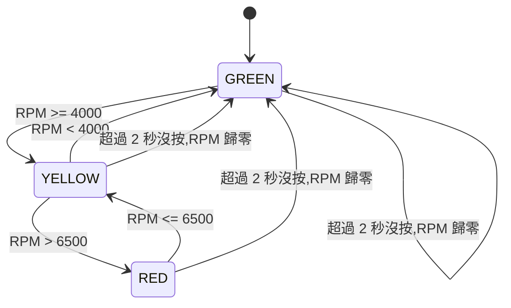

# 引擎轉速提示燈(NUCLEO-G474RE 期中專題)

按 B1 模擬引擎脈衝,量測兩次按下的時間差換算成 RPM,以綠 / 黃 / 紅燈提示轉速區間,過高時紅燈爆閃並蜂鳴器警告,同時透過 UART 輸出即時數據。

## 1. 情境故事

> 請依自己的情況修改這段(誰、在哪、遇到什麼麻煩)。

小明在北宜公路上練習當山道猴子,但是盯著轉速表又要看路況還要確認有沒有測速照相機,常常忘了換檔,讓引擎轉速衝過頭。他想要一個不用低頭看錶的提示燈:轉速正常亮綠燈,該換檔時亮黃燈,轉速過高時紅燈狂閃加蜂鳴器,一眼一耳就知道。

真實車輛的轉速來自曲軸感測器的脈衝,這個專題用 B1 按鈕模擬引擎脈衝:按得越快,代表轉速越高。


## 2. 替身對照:故事裡的模組 → 板上替身

| 故事裡的模組 | 板上替身 |
|---|---|
| 曲軸位置感測器(脈衝) | B1 按鈕(PC13,每按一次 = 一個脈衝) |
| 轉速計算 ECU | STM32G474RE(量測兩次脈衝的時間差) |
| 正常 / 換檔 / 過轉提示燈 | 綠燈、黃燈、紅燈(外接 LED) |
| 過轉警報聲 | 蜂鳴器(PA15,1.2 kHz) |
| 儀表板數據顯示 | USART2 → ST-LINK 虛擬 COM 埠 → 終端機 |

## 3. 功能與驗收條件

**轉速計算**:`RPM = 60,000,000 / Δt(µs) × K`,K = 30,Δt 為兩次有效按下的時間差。

| 狀態 | RPM 範圍 | 對應 Δt | 動作 |
|---|---|---|---|
| STATE 0 | < 4000 | > 450 ms | 綠燈亮 |
| STATE 1 | 4000 ~ 6500 | 277 ~ 450 ms | 黃燈亮 |
| STATE 2 | > 6500 | < 277 ms | 紅燈 10 Hz 爆閃,蜂鳴器 1.2 kHz 同步鳴叫 |



**其他功能**
- 按鈕去彈跳 20 ms。
- 超過 2 秒沒按,RPM 歸零並回到綠燈。
- 開機自我測試:綠 → 黃 → 紅 + 蜂鳴器,各 0.5 秒。
- UART 每 200 ms 輸出一行:`RPM:xx,STATE:x,DT:xx us,EXTI:xx`。

**驗收項目與實測結果**(請在實測後填寫)

| # | 驗收條件 | 預期 | 實測結果 |
|---|---|---|---|
| 1 | 開機自我測試 | 綠 → 黃 → 紅+蜂鳴器,各 0.5 秒 | ☐ 通過 |
| 2 | 每隔約 0.6 秒按一次 B1 | 綠燈,STATE:0 | ☐ 通過 |
| 3 | 每隔約 0.35 秒按一次 B1 | 黃燈,STATE:1 | ☐ 通過 |
| 4 | 每隔約 0.2 秒按一次 B1 | 紅燈 10 Hz 閃,蜂鳴器同步響,STATE:2 | ☐ 通過 |
| 5 | 停止按 2 秒以上 | RPM 歸零,回綠燈 | ☐ 通過 |
| 6 | 長按或抖動 B1 | 20 ms 內重複觸發被忽略 | ☐ 通過 |
| 7 | 終端機 115200 8N1 | 每 200 ms 一行輸出,格式正確 | ☐ 通過 |

## 4. 用到的技術

> 請對照課程投影片,把「週次」欄改成實際週次並勾選。

| 週次 | 技術 | 用在哪裡 | 使用 |
|---|---|---|---|
第 6 週	GPIO 輸出	紅燈 PA4	☑
第 6 週	外部中斷 EXTI	B1(PC13)上升緣觸發,量測脈衝	☑
第 6 週	Timer PWM	TIM2 控制黃 / 綠燈亮度;TIM8 產生蜂鳴器 1.2 kHz	☑
第 6 週	Timer 計時	TIM6 作 1 µs 計時器,輪詢 UIF 累計溢位,組成 32-bit 微秒時間	☑
第 7 週	UART	USART2 每 200 ms 輸出數據	☑
第 7 週	系統時鐘	HSI → PLL,HCLK 170 MHz	☑
第 7 週	狀態機	綠 / 黃 / 紅三段狀態切換	☑


## 5. 腳位表

| 腳位 | 功能 | 用途 |
|---|---|---|
PA0	TIM2_CH1	黃燈
PA1	TIM2_CH2	綠燈
PA4	GPIO_Output	紅燈
PA15	TIM8_CH1	蜂鳴器
PC13	GPIO_EXTI13	B1 按鈕
PA2 / PA3	USART2_TX / RX	串口

**Timer 參數**

| Timer | 時鐘 | PSC | ARR | 結果 |
|---|---|---|---|---|
| TIM2 | 170 MHz | 169 | 999 | PWM 1 kHz,Duty 500(50%) |
| TIM8 | 170 MHz | 169 | 832 | 約 1200 Hz,Pulse 416(50%) |
| TIM6 | 170 MHz | 169 | 65535 | 1 µs 計數,65.536 ms 溢位 |

**外接元件**:紅、黃、綠 LED 各串聯限流電阻(建議 330 Ω)接到對應腳位再接 GND;蜂鳴器接 PA15 與 GND。(請依實際接線修改)

## 6. 建置與執行

**開發環境**:STM32CubeIDE + STM32CubeMX,HAL 函式庫,NUCLEO-G474RE。

**燒錄步驟**
1. 用 CubeIDE 開啟專案(匯入本 repository 的專案資料夾)。
2. 以 USB 線連接 Nucleo 的 ST-LINK 口。
3. 按 **Run / Debug**,Debug 模式需按 **Resume(F8)** 讓程式執行。

**CubeMX 設定重點**
- Clock:HSI → PLL,M = 4、N = 85、R = 2,HCLK = 170 MHz。
- TIM2:CH1、CH2 為 PWM Generation,PSC = 169、ARR = 999。
- TIM8:CH1 為 PWM Generation,PSC = 169、ARR = 832、Pulse = 416。
- TIM6:Activated,PSC = 169、ARR = 65535,**不開中斷**。
- USART2:Asynchronous,115200、8N1。
- PC13:External Interrupt,Rising edge,NVIC 啟用 EXTI line[15:10]。
- Project Manager:取消勾選「Generate peripheral initialization as a pair of '.c/.h' files」。

**終端機設定**:115200 8N1,無流量控制(Tera Term、PuTTY 或支援 Web Serial 的網頁工具皆可)。

**命令**:本專案只輸出資料,沒有輸入命令。以下為輸出範例:

```
RPM:0,STATE:0,DT:0 us,EXTI:0
RPM:2571,STATE:0,DT:700000 us,EXTI:2
RPM:5142,STATE:1,DT:350000 us,EXTI:3
RPM:9000,STATE:2,DT:200000 us,EXTI:4
```

## 7. 程式結構

所有程式集中在 `Core/Src/main.c`(`MX_..._Init` 也寫在同一檔)。

| 區段 | 內容 |
|---|---|
| `Micros()` | 輪詢 TIM6 的 UIF 旗標累計溢位,回傳 32-bit 微秒時間 |
| `Button_Pulse_Handler()` | 在 EXTI 中斷內執行:20 ms 去彈跳、計算 Δt 與 RPM |
| `HAL_GPIO_EXTI_Callback` 等 | 同時提供 Rising / Falling / 通用三種 callback 名稱,皆導向同一處理函式 |
| `Outputs_Set()` | 一次設定黃 / 綠 / 紅 / 蜂鳴器輸出 |
| `Self_Test()` | 開機自我測試 |
| `Rpm_To_State()` | RPM 對應狀態 0 / 1 / 2 |
| `main()` 主迴圈 | 取得資料快照、檢查 2 秒逾時、狀態切換、紅燈 10 Hz 閃爍、200 ms UART 輸出 |

**ISR 與主迴圈分工**
- **EXTI 中斷**:只負責記錄時間戳、去彈跳、計算 Δt 與 RPM、累計脈衝數。
- **主迴圈**:負責逾時判斷、狀態機、輸出控制與 UART。
- 共用變數皆為 `volatile`,主迴圈讀取時短暫關閉中斷取得一致的快照。

## 8. 實作照片

> 請把照片放在 `docs/` 資料夾,並依實際檔名修改下方路徑。


*圖 1:接線完成的 NUCLEO-G474RE(請補上一行圖說)*


*圖 2:終端機輸出畫面(請補上一行圖說)*

## 9. AI 使用說明

> 請依實際情況修改,誠實寫出哪些由 AI 完成、你怎麼查核。

**請 AI 做的部分**
- 依我提供的需求(腳位、Timer 參數、狀態機規格)產生 `main.c` 完整程式與逐段註解。
- 整理 CubeMX 從零設定的步驟。
- 說明如何查看 UART 輸出與上傳 GitHub。

**我怎麼查核**
- 對照規格逐項檢查腳位與參數(PSC / ARR / AF 編號)是否與要求一致。
- 實際編譯、燒錄,依第 3 節驗收表逐項實測。
- 用終端機確認輸出格式與數值,手動按鈕驗證三段狀態與 2 秒逾時。
- 除錯經驗:測試過程中,我額外在板子上多接了一顆按鈕,導致前幾次測試都失敗;最後透過不斷向 AI 說明實際的硬體接線狀況,才找出問題所在。

## 10. 已知限制

- **B1 極性**:Nucleo 的 B1 按下時為低電位,Rising 觸發實際發生在**放開**的瞬間,對 Δt 無影響,但計時基準是放開時刻。
- **模擬性質**:K = 30 是此專題設定的係數,真實引擎需依曲軸齒數 / 每轉脈衝數換算。
- **最大可量測 RPM**:去彈跳 20 ms 下,最短可量測 Δt 為 20 ms,對應 RPM 上限約 90000。
- **UART 阻塞傳送**:每次輸出約 3.5 ms,紅燈閃爍有微小抖動,肉眼不易察覺。
- **逾時判斷**:最後一次按下後超過 2 秒視為停止;第一次按下只記錄時間,需第二次按下才會算出 RPM。
- **換真貨要改哪裡**:
  - 將 B1 換成霍爾感測器或光耦輸入,建議改用 Timer Input Capture 取代 EXTI,精度與抗抖動更好。
  - 依感測器每轉脈衝數修改 `RPM_K`。
  - 蜂鳴器與 LED 若電流較大,需加驅動電路(電晶體 / MOSFET)。
